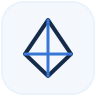

# Mogau Mothapo

### Software Engineer · Cloud & AI Engineering

Building useful software, learning how reliable systems work, and exploring where cloud and AI meet.

[**Portfolio**](https://mogau.niatren.com) &nbsp;·&nbsp;
[**LinkedIn**](https://www.linkedin.com/in/mogau-mothapo-trener) &nbsp;·&nbsp;
[**GitHub**](https://github.com/TrenerMogau)

## About

I'm a software engineering student at **WeThinkCode_** in Cape Town, South Africa. My foundation is software development, and I'm growing toward **cloud and AI engineering** through practical projects, experimentation, and continuous learning.

- Building a stronger foundation in cloud infrastructure and deployment.
- Exploring AI-powered applications and practical automation.
- Interested in system design, secure software, and developer experience.
- Enjoy collaborating, sharing knowledge, and learning by building.

## Focus areas

<table>
<tr>
<td width="50%" valign="top">

**Software engineering**

Java, Python, TypeScript, APIs, backend development, and maintainable application design.
</td>
<td width="50%" valign="top">

**Cloud & delivery**

Cloud fundamentals, Linux, containers, CI/CD, deployment workflows, and infrastructure.
</td>
</tr>
<tr>
<td width="50%" valign="top">

**AI engineering**

Exploring AI-enabled products, intelligent workflows, and practical integrations.
</td>
<td width="50%" valign="top">

**Reliable systems**

Software architecture, security-minded development, testing, and automation.
</td>
</tr>
</table>

## Technologies

  

  

  

My toolkit is evolving as I gain experience. These icons represent technologies I've worked with or am actively learning, not a claim of equal proficiency across all of them.

## Selected work

<table>
<tr>
<td width="50%" valign="top">

**[System Design Compilation](https://github.com/TrenerMogau/system-design-compilation)**

A collection of system-design learning resources and references.
</td>
<td width="50%" valign="top">

**[SupaCommerce](https://github.com/TrenerMogau/supacommerce)**

A commerce-related development project.
</td>
</tr>
<tr>
<td colspan="2">

**[Portfolio](https://mogau.niatren.com)**

More about my work, projects, and current engineering interests.
</td>
</tr>
</table>

## Currently exploring

- Cloud-native application design and deployment
- AI-powered applications and automation
- CI/CD and container-based development workflows
- Secure, maintainable software architecture

**Build thoughtfully. Deploy reliably. Keep learning.**

Cape Town, South Africa · Open to learning, collaboration, and meaningful engineering work

